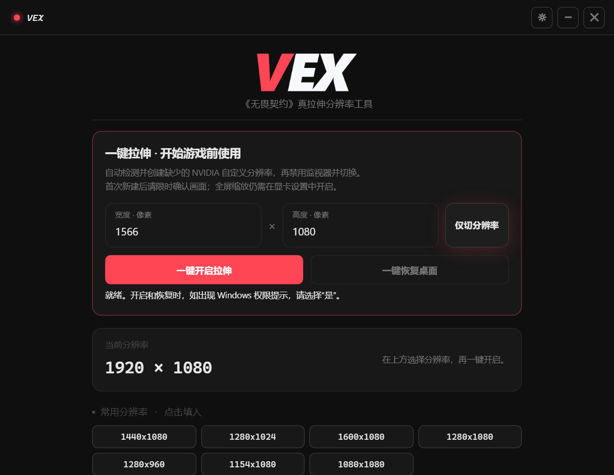

# VEX

**原作者：[ahhmilo](https://github.com/ahhmilo) · 原项目：[EasyTS](https://github.com/ahhmilo/EasyTS)**  
**修改与维护：[vexeton / vexetonn](https://github.com/vexetonn)**

VEX 是基于 EasyTS v4.2.0 的显示分辨率工具，提供监视器控制、分辨率切换和桌面恢复。原作者署名与原始 [LICENSE](LICENSE) 完整保留，来源说明见 [ATTRIBUTION.md](ATTRIBUTION.md)。

## 下载

**[下载 VEX.exe](https://github.com/vexetonn/EasyTS-zh-CN/releases/download/v1.1.0/VEX.exe)** · **[下载便携包](https://github.com/vexetonn/EasyTS-zh-CN/releases/download/v1.1.0/VEX-portable.zip)** · [全部版本](https://github.com/vexetonn/EasyTS-zh-CN/releases)

适用于 Windows 10/11 x64，无需安装 Python。缺少 WebView2 时程序会提供安装引导。

## 使用

1. 分别输入目标宽度和高度。NVIDIA 直接控制主显示器时，程序会自动创建缺少的分辨率；显卡全屏缩放仍需设置。
2. 启动游戏前，点击“一键开启拉伸”，允许所需的 Windows 管理员操作。首次新建模式后，在 20 秒内点击“画面正常，保留”；否则自动恢复。
3. 完成后启动游戏，选择窗口化全屏和填充。
4. 用完点击“一键恢复桌面”，或保持 VEX 运行并开启退出游戏后自动恢复。

默认 `Ctrl + Alt + S` 只切换分辨率，便于菜单与对局之间切换。恢复时只重新启用本次禁用的设备，原先已禁用的设备保持原状。本版会处理全部当前连接且已启用的监视器。

为兼容旧配置，设置仍保存于 `%LOCALAPPDATA%\EasyTS`。请退出其他版本再使用。

输入框支持鼠标拖选文字，窗口只可从顶部标题栏拖动。自动创建的模式保留在驱动中。非 NVIDIA 直连、混合显卡或驱动不支持时会明确提示，详见 [NVIDIA 自动创建说明](docs/NVIDIA.md)。

## 文档与构建

- [使用说明与构建步骤](README.usage.md)
- [更新记录](CHANGELOG.md)
- [作者与版权](ATTRIBUTION.md)
- [原作者说明](README.upstream.md)
- [验证记录](验证记录.json)

在 Windows x64、Python 3.12 环境中运行 `build.ps1`，生成 `dist\VEX.exe`。实际拉伸效果取决于显卡和游戏设置，尚未实测游戏内效果。
